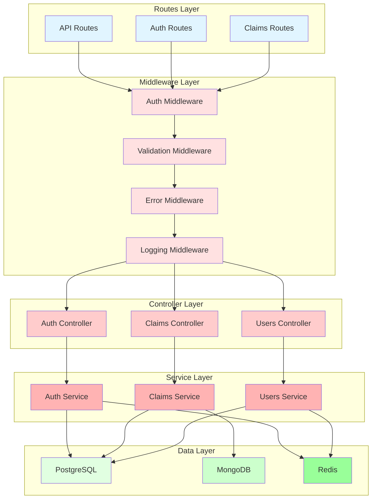

# Backend Architecture

## Overview

The ClaimForge backend is built with Node.js, TypeScript, and Express, following a layered architecture pattern for maintainability and scalability.

## Directory Structure

```
backend/
├── src/
│   ├── config/         # Configuration files
│   ├── controllers/    # Request handlers
│   ├── middleware/     # Express middleware
│   ├── models/         # Data models and schemas
│   ├── routes/         # API route definitions
│   │   ├── api/       # General API routes
│   │   ├── auth/      # Authentication routes
│   │   ├── claims/    # Claims management routes
│   │   ├── users/     # User management routes
│   │   └── audit/     # Audit log routes
│   ├── services/      # Business logic
│   ├── types/         # TypeScript types
│   ├── utils/         # Utility functions
│   └── index.ts       # Application entry point
└── package.json
```

## Architecture Layers



## Application Entry Point

```typescript
// src/index.ts
import express from 'express';
import cors from 'cors';
import helmet from 'helmet';
import rateLimit from 'express-rate-limit';
import { config } from './config';
import { errorHandler } from './middleware/errorHandler';
import { logger } from './utils/logger';
import { authRoutes } from './routes/auth';
import { claimsRoutes } from './routes/claims';
import { usersRoutes } from './routes/users';
import { auditRoutes } from './routes/audit';

const app = express();

// Security middleware
app.use(helmet());
app.use(cors({
  origin: config.corsOrigin,
  credentials: true,
}));

// Rate limiting
const limiter = rateLimit({
  windowMs: 15 * 60 * 1000, // 15 minutes
  max: 100, // limit each IP to 100 requests per windowMs
});
app.use('/api/', limiter);

// Body parsing
app.use(express.json({ limit: '10mb' }));
app.use(express.urlencoded({ extended: true }));

// Request logging
app.use((req, res, next) => {
  logger.info(`${req.method} ${req.path}`, {
    ip: req.ip,
    userAgent: req.get('user-agent'),
  });
  next();
});

// Health check
app.get('/health', (req, res) => {
  res.json({ status: 'healthy', timestamp: new Date().toISOString() });
});

// API routes
app.use('/api/auth', authRoutes);
app.use('/api/claims', claimsRoutes);
app.use('/api/users', usersRoutes);
app.use('/api/audit', auditRoutes);

// Error handling
app.use(errorHandler);

// Start server
const PORT = config.port;
app.listen(PORT, () => {
  logger.info(`Server running on port ${PORT}`);
});
```

## Configuration Management

```typescript
// src/config/index.ts
import dotenv from 'dotenv';

dotenv.config();

export const config = {
  port: parseInt(process.env.PORT || '8000'),
  nodeEnv: process.env.NODE_ENV || 'development',

  database: {
    postgres: {
      host: process.env.POSTGRES_HOST || 'localhost',
      port: parseInt(process.env.POSTGRES_PORT || '5432'),
      database: process.env.POSTGRES_DB || 'claimforge',
      user: process.env.POSTGRES_USER || 'claimforge_user',
      password: process.env.POSTGRES_PASSWORD || 'password',
    },
    mongodb: {
      uri: process.env.MONGODB_URI || 'mongodb://localhost:27017/claimforge_docs',
    },
    redis: {
      host: process.env.REDIS_HOST || 'localhost',
      port: parseInt(process.env.REDIS_PORT || '6379'),
      password: process.env.REDIS_PASSWORD,
    },
  },

  jwt: {
    secret: process.env.JWT_SECRET || 'your-secret-key',
    expiresIn: process.env.JWT_EXPIRES_IN || '1h',
    refreshExpiresIn: process.env.JWT_REFRESH_EXPIRES_IN || '7d',
  },

  corsOrigin: process.env.CORS_ORIGIN || 'http://localhost:3000',
};
```

## Middleware

### Authentication Middleware

```typescript
// src/middleware/auth.ts
import { Request, Response, NextFunction } from 'express';
import jwt from 'jsonwebtoken';
import { config } from '../config';

export interface AuthRequest extends Request {
  user?: {
    id: string;
    email: string;
    roles: string[];
  };
}

export function authenticate(req: AuthRequest, res: Response, next: NextFunction) {
  const token = req.headers.authorization?.replace('Bearer ', '');

  if (!token) {
    return res.status(401).json({ error: 'No token provided' });
  }

  try {
    const decoded = jwt.verify(token, config.jwt.secret) as any;
    req.user = decoded;
    next();
  } catch (error) {
    return res.status(401).json({ error: 'Invalid token' });
  }
}

export function authorize(...roles: string[]) {
  return (req: AuthRequest, res: Response, next: NextFunction) => {
    if (!req.user) {
      return res.status(401).json({ error: 'Not authenticated' });
    }

    const hasRole = roles.some(role => req.user!.roles.includes(role));
    if (!hasRole) {
      return res.status(403).json({ error: 'Insufficient permissions' });
    }

    next();
  };
}
```

### Validation Middleware

```typescript
// src/middleware/validation.ts
import { Request, Response, NextFunction } from 'express';
import { z, ZodSchema } from 'zod';

export function validate(schema: ZodSchema) {
  return (req: Request, res: Response, next: NextFunction) => {
    try {
      schema.parse(req.body);
      next();
    } catch (error) {
      if (error instanceof z.ZodError) {
        return res.status(400).json({
          error: 'Validation error',
          details: error.errors,
        });
      }
      next(error);
    }
  };
}
```

### Error Handling Middleware

```typescript
// src/middleware/errorHandler.ts
import { Request, Response, NextFunction } from 'express';
import { logger } from '../utils/logger';

export function errorHandler(
  error: Error,
  req: Request,
  res: Response,
  next: NextFunction
) {
  logger.error('Error occurred', {
    error: error.message,
    stack: error.stack,
    path: req.path,
    method: req.method,
  });

  if (res.headersSent) {
    return next(error);
  }

  const isDevelopment = process.env.NODE_ENV === 'development';

  res.status(500).json({
    error: 'Internal server error',
    ...(isDevelopment && { message: error.message, stack: error.stack }),
  });
}
```

## Controllers

### Claims Controller

```typescript
// src/controllers/claimsController.ts
import { Request, Response } from 'express';
import { claimsService } from '../services/claimsService';
import { AuthRequest } from '../middleware/auth';

export const claimsController = {
  async getAllClaims(req: Request, res: Response) {
    const filters = req.query;
    const claims = await claimsService.getAllClaims(filters);
    res.json(claims);
  },

  async getClaimById(req: Request, res: Response) {
    const { id } = req.params;
    const claim = await claimsService.getClaimById(id);
    res.json(claim);
  },

  async createClaim(req: AuthRequest, res: Response) {
    const data = req.body;
    const userId = req.user!.id;
    const claim = await claimsService.createClaim(data, userId);
    res.status(201).json(claim);
  },

  async updateClaim(req: Request, res: Response) {
    const { id } = req.params;
    const data = req.body;
    const claim = await claimsService.updateClaim(id, data);
    res.json(claim);
  },

  async deleteClaim(req: Request, res: Response) {
    const { id } = req.params;
    await claimsService.deleteClaim(id);
    res.status(204).send();
  },
};
```

## Services

### Claims Service

```typescript
// src/services/claimsService.ts
import { db } from '../config/database';
import { redis } from '../config/redis';
import { auditService } from './auditService';

export class ClaimsService {
  async getAllClaims(filters: any) {
    const cacheKey = `claims:${JSON.stringify(filters)}`;
    const cached = await redis.get(cacheKey);

    if (cached) {
      return JSON.parse(cached);
    }

    const claims = await db.claim.findMany({
      where: filters,
      include: {
        user: true,
        documents: true,
      },
    });

    await redis.setex(cacheKey, 300, JSON.stringify(claims)); // 5 minutes
    return claims;
  }

  async getClaimById(id: string) {
    const claim = await db.claim.findUnique({
      where: { id },
      include: {
        user: true,
        documents: true,
        notes: true,
      },
    });

    if (!claim) {
      throw new Error('Claim not found');
    }

    return claim;
  }

  async createClaim(data: any, userId: string) {
    const claim = await db.claim.create({
      data: {
        ...data,
        userId,
        claimNumber: await this.generateClaimNumber(),
      },
    });

    await auditService.logAction({
      userId,
      action: 'create_claim',
      resourceType: 'claim',
      resourceId: claim.id,
      details: data,
    });

    // Invalidate cache
    await redis.del('claims:*');

    return claim;
  }

  async updateClaim(id: string, data: any) {
    const oldClaim = await this.getClaimById(id);

    const claim = await db.claim.update({
      where: { id },
      data,
    });

    await auditService.logAction({
      userId: claim.userId,
      action: 'update_claim',
      resourceType: 'claim',
      resourceId: id,
      details: {
        old: oldClaim,
        new: claim,
      },
    });

    await redis.del(`claims:${id}`);
    await redis.del('claims:*');

    return claim;
  }

  async deleteClaim(id: string) {
    await db.claim.delete({
      where: { id },
    });

    await redis.del(`claims:${id}`);
    await redis.del('claims:*');
  }

  private async generateClaimNumber(): Promise<string> {
    const prefix = 'CLM';
    const timestamp = Date.now().toString(36).toUpperCase();
    const random = Math.random().toString(36).substring(2, 6).toUpperCase();
    return `${prefix}-${timestamp}-${random}`;
  }
}

export const claimsService = new ClaimsService();
```

## Routes

### Claims Routes

```typescript
// src/routes/claims/index.ts
import { Router } from 'express';
import { claimsController } from '../../controllers/claimsController';
import { authenticate, authorize } from '../../middleware/auth';
import { validate } from '../../middleware/validation';
import { createClaimSchema, updateClaimSchema } from '../../models/claim';

const router = Router();

// All routes require authentication
router.use(authenticate);

// Get all claims (adjusters and above)
router.get('/', authorize('adjuster', 'reviewer', 'manager', 'admin'), claimsController.getAllClaims);

// Get specific claim
router.get('/:id', claimsController.getClaimById);

// Create claim (all authenticated users)
router.post('/', validate(createClaimSchema), claimsController.createClaim);

// Update claim (adjusters and above)
router.put('/:id', authorize('adjuster', 'reviewer', 'manager', 'admin'), validate(updateClaimSchema), claimsController.updateClaim);

// Delete claim (managers and admins only)
router.delete('/:id', authorize('manager', 'admin'), claimsController.deleteClaim);

export { router as claimsRoutes };
```

## Database Access

### PostgreSQL with Prisma

```typescript
// src/config/database.ts
import { PrismaClient } from '@prisma/client';

export const db = new PrismaClient({
  log: process.env.NODE_ENV === 'development' ? ['query', 'error', 'warn'] : ['error'],
});

// Graceful shutdown
process.on('beforeExit', async () => {
  await db.$disconnect();
});
```

### MongoDB

```typescript
// src/config/mongodb.ts
import { MongoClient } from 'mongodb';

let client: MongoClient;

export async function connectMongoDB() {
  if (!client) {
    client = new MongoClient(process.env.MONGODB_URI!);
    await client.connect();
  }
  return client;
}

export function getMongoDB() {
  if (!client) {
    throw new Error('MongoDB not connected');
  }
  return client.db();
}
```

### Redis

```typescript
// src/config/redis.ts
import { createClient } from 'redis';

export const redis = createClient({
  url: process.env.REDIS_URI,
});

redis.on('error', (err) => console.error('Redis Client Error', err));

export async function connectRedis() {
  await redis.connect();
}
```

## Logging

```typescript
// src/utils/logger.ts
import winston from 'winston';

export const logger = winston.createLogger({
  level: process.env.LOG_LEVEL || 'info',
  format: winston.format.combine(
    winston.format.timestamp(),
    winston.format.errors({ stack: true }),
    winston.format.json()
  ),
  transports: [
    new winston.transports.Console({
      format: winston.format.combine(
        winston.format.colorize(),
        winston.format.simple()
      ),
    }),
    new winston.transports.File({ filename: 'error.log', level: 'error' }),
    new winston.transports.File({ filename: 'combined.log' }),
  ],
});
```

## Validation Schemas

```typescript
// src/models/claim.ts
import { z } from 'zod';

export const createClaimSchema = z.object({
  policyNumber: z.string().min(1),
  incidentDate: z.string().datetime(),
  claimAmount: z.number().positive(),
  description: z.string().min(10).max(1000),
});

export const updateClaimSchema = z.object({
  status: z.enum(['submitted', 'under_review', 'investigating', 'approved', 'denied', 'settled', 'closed']).optional(),
  settlementAmount: z.number().positive().optional(),
  description: z.string().min(10).max(1000).optional(),
});

export type CreateClaimDto = z.infer<typeof createClaimSchema>;
export type UpdateClaimDto = z.infer<typeof updateClaimSchema>;
```

## Testing

### Unit Tests

```typescript
// tests/unit/claimsService.test.ts
import { ClaimsService } from '../../src/services/claimsService';
import { db } from '../../src/config/database';

jest.mock('../../src/config/database');

describe('ClaimsService', () => {
  let service: ClaimsService;

  beforeEach(() => {
    service = new ClaimsService();
  });

  test('should create a claim', async () => {
    const mockClaim = { id: '1', claimNumber: 'CLM-123' };
    (db.claim.create as jest.Mock).mockResolvedValue(mockClaim);

    const result = await service.createClaim({ policyNumber: 'POL123' }, 'user1');
    expect(result).toEqual(mockClaim);
  });
});
```

### Integration Tests

```typescript
// tests/integration/claims.test.ts
import request from 'supertest';
import app from '../../src/index';

describe('Claims API', () => {
  test('GET /api/claims should return claims', async () => {
    const response = await request(app)
      .get('/api/claims')
      .set('Authorization', 'Bearer valid-token');

    expect(response.status).toBe(200);
    expect(Array.isArray(response.body)).toBe(true);
  });
});
```

## TypeScript Configuration

```json
{
  "compilerOptions": {
    "target": "ES2022",
    "module": "NodeNext",
    "moduleResolution": "NodeNext",
    "lib": ["ES2022"],
    "outDir": "./dist",
    "rootDir": "./src",
    "strict": true,
    "esModuleInterop": true,
    "skipLibCheck": true,
    "forceConsistentCasingInFileNames": true,
    "resolveJsonModule": true,
    "declaration": true,
    "declarationMap": true,
    "sourceMap": true
  },
  "include": ["src/**/*"],
  "exclude": ["node_modules", "dist", "tests"]
}
```
