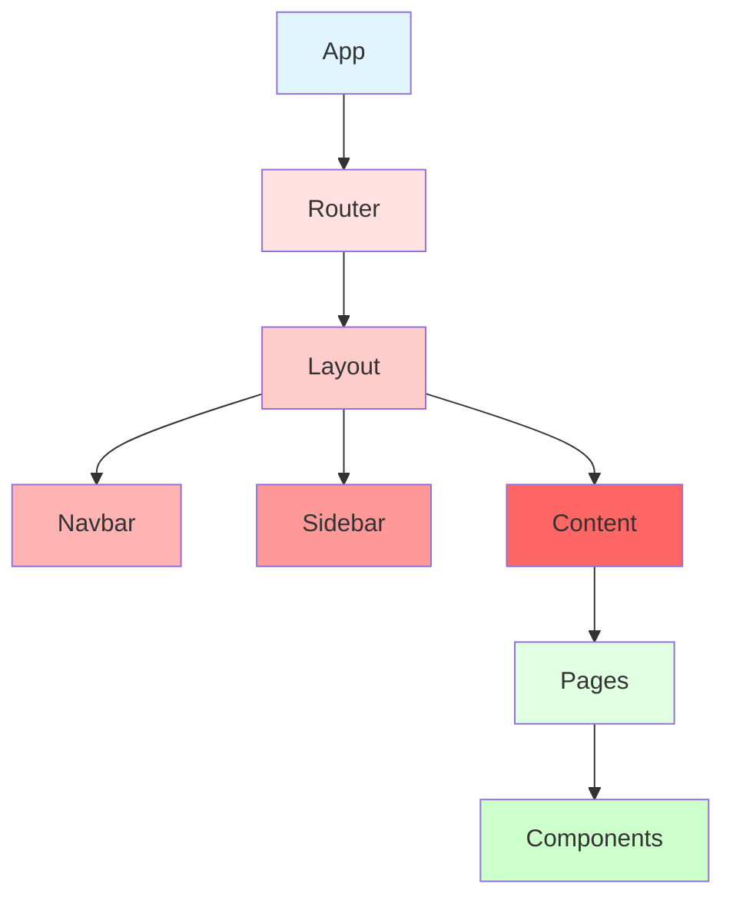

# Frontend Architecture

## Overview

The ClaimForge frontend is built with React 18 and TypeScript, following modern best practices for scalable, maintainable applications.

## Directory Structure

```
frontend/
├── src/
│   ├── components/      # Reusable UI components
│   ├── pages/          # Page-level components
│   ├── hooks/          # Custom React hooks
│   ├── services/       # API client services
│   ├── store/          # Zustand state management
│   ├── types/          # TypeScript type definitions
│   └── utils/          # Utility functions
├── public/             # Static assets
└── package.json
```

## Component Architecture

### Component Hierarchy



### Component Types

#### 1. Layout Components
- **App**: Root component with providers
- **Layout**: Main layout wrapper
- **Navbar**: Navigation bar
- **Sidebar**: Sidebar navigation

#### 2. Page Components
- **Dashboard**: Main dashboard
- **ClaimsList**: Claims listing page
- **ClaimDetail**: Individual claim view
- **ClaimForm**: Claim creation/editing
- **UserProfile**: User profile management

#### 3. Shared Components
- **Button**: Reusable button
- **Input**: Form input fields
- **Modal**: Modal dialogs
- **Table**: Data tables
- **Card**: Card containers
- **StatusBadge**: Status indicators

## State Management

### Client State (Zustand)

Zustand is used for client-side state that doesn't need to be persisted:

```typescript
// store/authStore.ts
interface AuthState {
  user: User | null;
  token: string | null;
  isAuthenticated: boolean;
  login: (credentials: Credentials) => Promise<void>;
  logout: () => void;
}

const useAuthStore = create<AuthState>((set) => ({
  user: null,
  token: null,
  isAuthenticated: false,
  login: async (credentials) => {
    // Login logic
  },
  logout: () => {
    // Logout logic
  },
}));
```

### Server State (React Query)

React Query manages server state with caching, synchronization, and background updates:

```typescript
// hooks/useClaims.ts
export function useClaims(filters?: ClaimFilters) {
  return useQuery({
    queryKey: ['claims', filters],
    queryFn: () => claimsService.getClaims(filters),
    staleTime: 5 * 60 * 1000, // 5 minutes
  });
}

export function useClaim(id: string) {
  return useQuery({
    queryKey: ['claim', id],
    queryFn: () => claimsService.getClaim(id),
  });
}
```

## API Layer

### Service Structure

```typescript
// services/claimsService.ts
import axios from 'axios';

const api = axios.create({
  baseURL: import.meta.env.VITE_API_URL,
  headers: {
    'Content-Type': 'application/json',
  },
});

// Request interceptor for auth token
api.interceptors.request.use((config) => {
  const token = useAuthStore.getState().token;
  if (token) {
    config.headers.Authorization = `Bearer ${token}`;
  }
  return config;
});

export const claimsService = {
  getClaims: (filters?: ClaimFilters) =>
    api.get<Claim[]>('/api/claims', { params: filters }),

  getClaim: (id: string) =>
    api.get<Claim>(`/api/claims/${id}`),

  createClaim: (data: CreateClaimDto) =>
    api.post<Claim>('/api/claims', data),

  updateClaim: (id: string, data: UpdateClaimDto) =>
    api.put<Claim>(`/api/claims/${id}`, data),

  deleteClaim: (id: string) =>
    api.delete(`/api/claims/${id}`),
};
```

## Routing

React Router manages client-side routing:

```typescript
// App.tsx
import { BrowserRouter, Routes, Route } from 'react-router-dom';

function App() {
  return (
    <BrowserRouter>
      <Routes>
        <Route path="/" element={<Layout />}>
          <Route index element={<Dashboard />} />
          <Route path="claims" element={<ClaimsList />} />
          <Route path="claims/:id" element={<ClaimDetail />} />
          <Route path="claims/new" element={<ClaimForm />} />
          <Route path="profile" element={<UserProfile />} />
        </Route>
        <Route path="/login" element={<Login />} />
      </Routes>
    </BrowserRouter>
  );
}
```

## Custom Hooks

### Authentication Hook

```typescript
// hooks/useAuth.ts
export function useAuth() {
  const { user, token, isAuthenticated, login, logout } = useAuthStore();

  useEffect(() => {
    // Check for existing token on mount
    const storedToken = localStorage.getItem('token');
    if (storedToken) {
      // Validate token and set user
    }
  }, []);

  return { user, token, isAuthenticated, login, logout };
}
```

### Form Hook

```typescript
// hooks/useForm.ts
export function useForm<T>(initialValues: T, validation: ValidationSchema<T>) {
  const [values, setValues] = useState<T>(initialValues);
  const [errors, setErrors] = useState<Errors<T>>({});
  const [touched, setTouched] = useState<Touched<T>>({});

  const handleChange = (name: keyof T, value: any) => {
    setValues((prev) => ({ ...prev, [name]: value }));
  };

  const handleBlur = (name: keyof T) => {
    setTouched((prev) => ({ ...prev, [name]: true }));
    const fieldErrors = validation[name]?.(values[name]);
    setErrors((prev) => ({ ...prev, [name]: fieldErrors }));
  };

  const validate = () => {
    const allErrors = validation.validate?.(values) || {};
    setErrors(allErrors);
    return Object.keys(allErrors).length === 0;
  };

  return { values, errors, touched, handleChange, handleBlur, validate };
}
```

## Type Safety

### Shared Types

```typescript
// types/claim.ts
export interface Claim {
  id: string;
  claimNumber: string;
  userId: string;
  status: ClaimStatus;
  claimAmount: number;
  settlementAmount?: number;
  policyNumber: string;
  incidentDate: string;
  filedDate: string;
  description: string;
  createdAt: string;
  updatedAt: string;
}

export type ClaimStatus =
  | 'submitted'
  | 'under_review'
  | 'investigating'
  | 'approved'
  | 'denied'
  | 'settled'
  | 'closed';

export interface CreateClaimDto {
  policyNumber: string;
  incidentDate: string;
  claimAmount: number;
  description: string;
}

export interface UpdateClaimDto {
  status?: ClaimStatus;
  settlementAmount?: number;
  description?: string;
}
```

## Styling Strategy

### Tailwind CSS Configuration

```javascript
// tailwind.config.js
export default {
  content: ['./index.html', './src/**/*.{js,ts,jsx,tsx}'],
  theme: {
    extend: {
      colors: {
        primary: {
          50: '#e1f5ff',
          100: '#b3d9ff',
          500: '#0066cc',
          600: '#0052a3',
          700: '#003d7a',
        },
      },
    },
  },
  plugins: [],
};
```

### Component Styling

```typescript
// components/Button.tsx
interface ButtonProps {
  variant?: 'primary' | 'secondary' | 'danger';
  size?: 'sm' | 'md' | 'lg';
  children: React.ReactNode;
  onClick?: () => void;
}

export function Button({ variant = 'primary', size = 'md', children, onClick }: ButtonProps) {
  const baseClasses = 'rounded font-medium transition-colors';
  const variantClasses = {
    primary: 'bg-primary-600 text-white hover:bg-primary-700',
    secondary: 'bg-gray-200 text-gray-800 hover:bg-gray-300',
    danger: 'bg-red-600 text-white hover:bg-red-700',
  };
  const sizeClasses = {
    sm: 'px-3 py-1 text-sm',
    md: 'px-4 py-2',
    lg: 'px-6 py-3 text-lg',
  };

  return (
    <button
      className={`${baseClasses} ${variantClasses[variant]} ${sizeClasses[size]}`}
      onClick={onClick}
    >
      {children}
    </button>
  );
}
```

## Performance Optimization

### Code Splitting

```typescript
// Lazy load routes
const ClaimDetail = lazy(() => import('./pages/ClaimDetail'));
const ClaimForm = lazy(() => import('./pages/ClaimForm'));

// In routes
<Route path="claims/:id" element={<Suspense fallback={<Loading />}><ClaimDetail /></Suspense>} />
```

### Memoization

```typescript
// Use React.memo for expensive components
export const ClaimCard = React.memo(({ claim }: { claim: Claim }) => {
  // Component logic
});

// Use useMemo for expensive calculations
const filteredClaims = useMemo(() => {
  return claims.filter(claim => claim.status === filter);
}, [claims, filter]);
```

### Virtual Scrolling

For large lists, implement virtual scrolling to render only visible items.

## Error Handling

### Error Boundaries

```typescript
// components/ErrorBoundary.tsx
class ErrorBoundary extends React.Component {
  state = { hasError: false, error: null };

  static getDerivedStateFromError(error: Error) {
    return { hasError: true, error };
  }

  componentDidCatch(error: Error, errorInfo: React.ErrorInfo) {
    console.error('Error caught by boundary:', error, errorInfo);
    // Log to error tracking service
  }

  render() {
    if (this.state.hasError) {
      return <ErrorFallback error={this.state.error} />;
    }
    return this.props.children;
  }
}
```

### API Error Handling

```typescript
// services/api.ts
api.interceptors.response.use(
  (response) => response,
  (error) => {
    if (error.response?.status === 401) {
      // Redirect to login
      useAuthStore.getState().logout();
      window.location.href = '/login';
    }
    return Promise.reject(error);
  }
);
```

## Testing Strategy

### Component Testing

```typescript
// components/Button.test.tsx
import { render, screen } from '@testing-library/react';
import { Button } from './Button';

test('renders button with text', () => {
  render(<Button>Click me</Button>);
  expect(screen.getByText('Click me')).toBeInTheDocument();
});
```

### Hook Testing

```typescript
// hooks/useAuth.test.ts
import { renderHook, act } from '@testing-library/react';
import { useAuth } from './useAuth';

test('login updates auth state', async () => {
  const { result } = renderHook(() => useAuth());
  await act(async () => {
    await result.current.login({ email: 'test@example.com', password: 'password' });
  });
  expect(result.current.isAuthenticated).toBe(true);
});
```

## Accessibility

### ARIA Labels

```typescript
<button
  aria-label="Close modal"
  onClick={onClose}
>
  <CloseIcon />
</button>
```

### Keyboard Navigation

Ensure all interactive elements are keyboard accessible with proper focus management.

### Screen Reader Support

Use semantic HTML and ARIA attributes for screen reader compatibility.

## Build Configuration

### Vite Config

```typescript
// vite.config.ts
import { defineConfig } from 'vite';
import react from '@vitejs/plugin-react';

export default defineConfig({
  plugins: [react()],
  server: {
    port: 3000,
    proxy: {
      '/api': {
        target: 'http://localhost:8000',
        changeOrigin: true,
      },
    },
  },
  build: {
    outDir: 'dist',
    sourcemap: true,
    rollupOptions: {
      output: {
        manualChunks: {
          vendor: ['react', 'react-dom', 'react-router-dom'],
          ui: ['@tanstack/react-query', 'zustand'],
        },
      },
    },
  },
});
```
