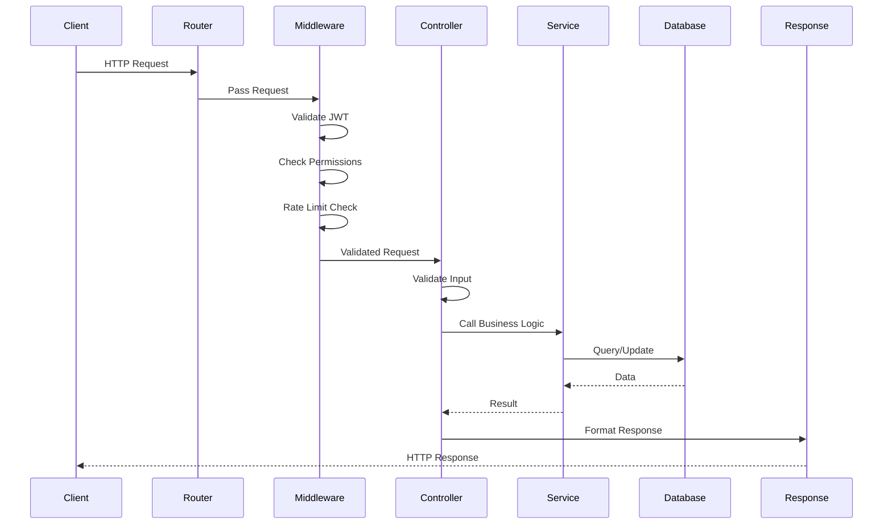
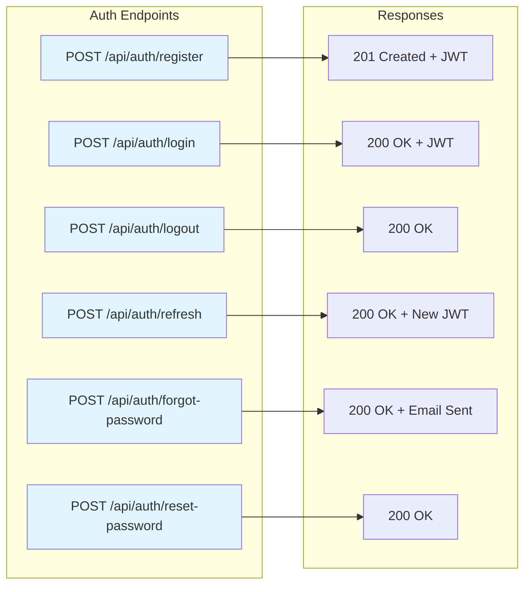
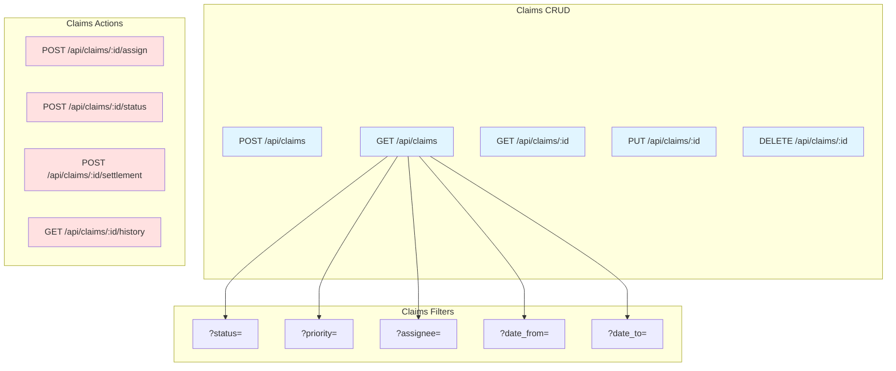
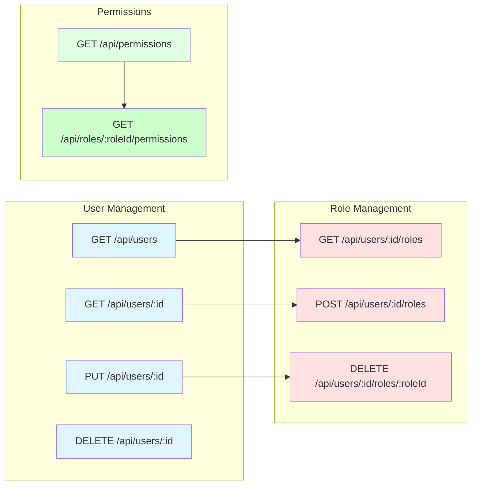
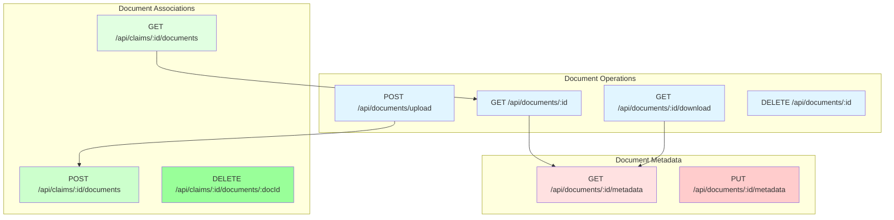
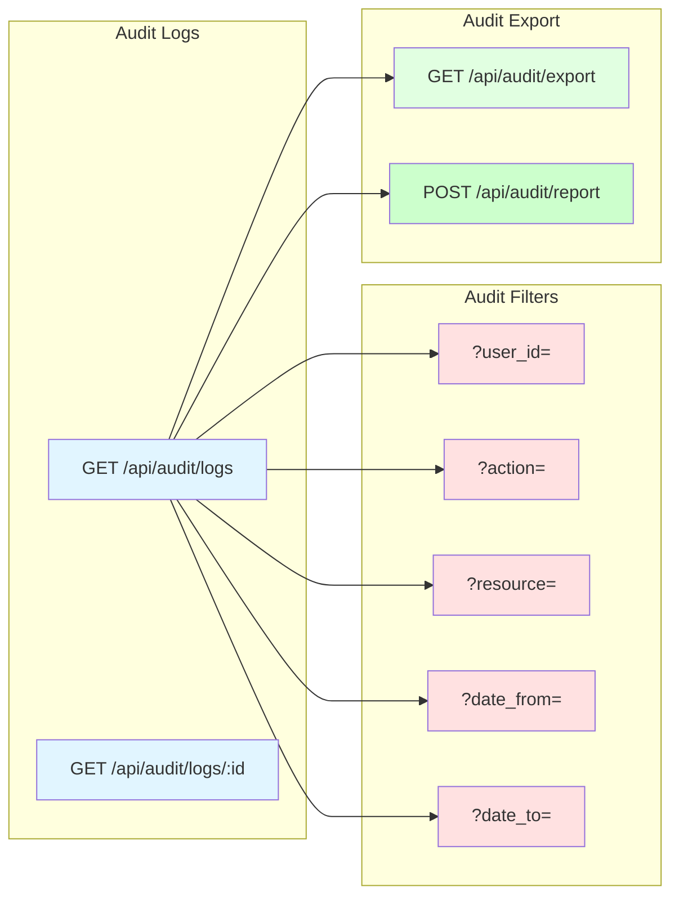
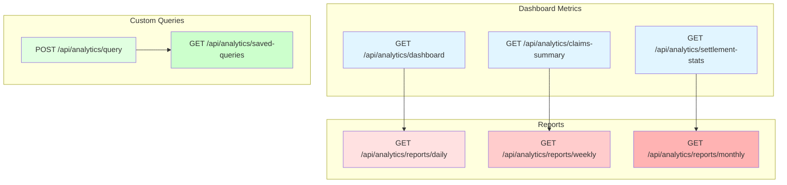
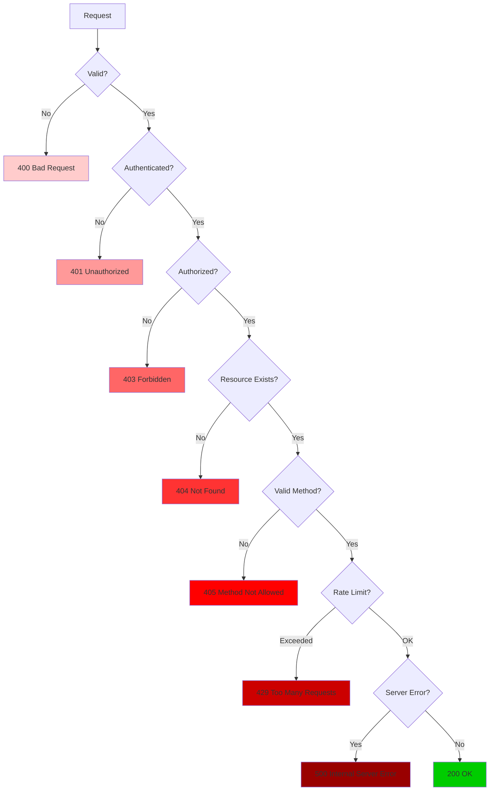
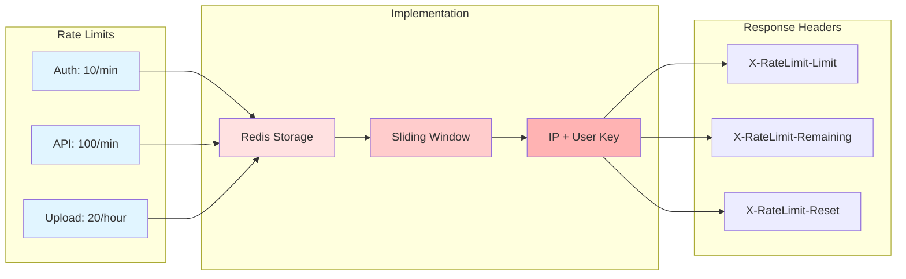

# API Design Diagrams

## API Architecture Overview

```mermaid
graph TB
    subgraph "REST API Endpoints"
        A[/api/auth]
        B[/api/users]
        C[/api/claims]
        D[/api/documents]
        E[/api/audit]
        F[/api/analytics]
    end

    subgraph "Authentication Middleware"
        M1[JWT Validation]
        M2[Role Check]
        M3[Rate Limiting]
    end

    subgraph "Controllers"
        C1[Auth Controller]
        C2[User Controller]
        C3[Claim Controller]
        C4[Document Controller]
        C5[Audit Controller]
        C6[Analytics Controller]
    end

    subgraph "Services"
        S1[Auth Service]
        S2[User Service]
        S3[Claim Service]
        S4[Document Service]
        S5[Audit Service]
        S6[Analytics Service]
    end

    A --> M1
    B --> M1
    C --> M1
    D --> M1
    E --> M1
    F --> M1

    M1 --> M2
    M2 --> M3

    A --> C1
    B --> C2
    C --> C3
    D --> C4
    E --> C5
    F --> C6

    C1 --> S1
    C2 --> S2
    C3 --> S3
    C4 --> S4
    C5 --> S5
    C6 --> S6

    style A fill:#e1f5ff
    style B fill:#e1f5ff
    style C fill:#e1f5ff
    style D fill:#e1f5ff
    style E fill:#e1f5ff
    style F fill:#e1f5ff
    style M1 fill:#ffe1e1
    style M2 fill:#ffcccc
    style M3 fill:#ffb3b3
```

## API Request Flow



## Authentication API



## Claims API



## Users API



## Documents API



## Audit API



## Analytics API



## Error Handling Flow



## Rate Limiting Strategy


