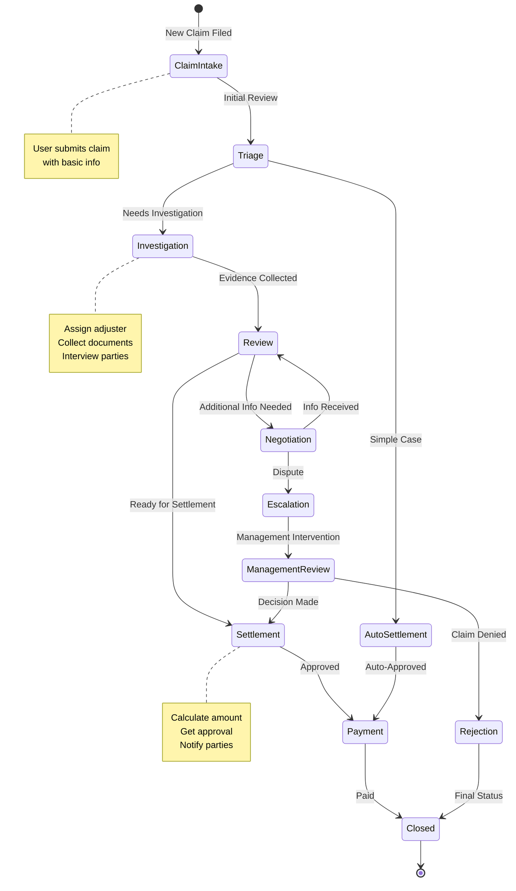
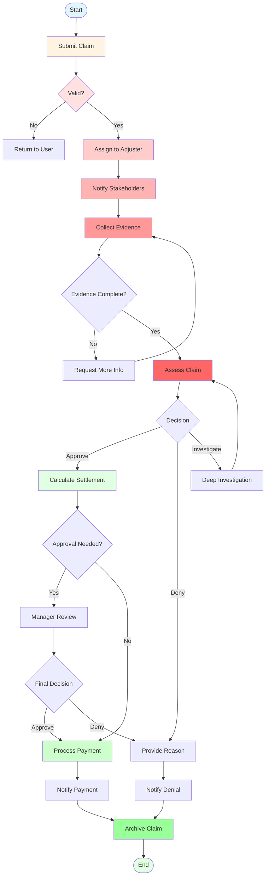
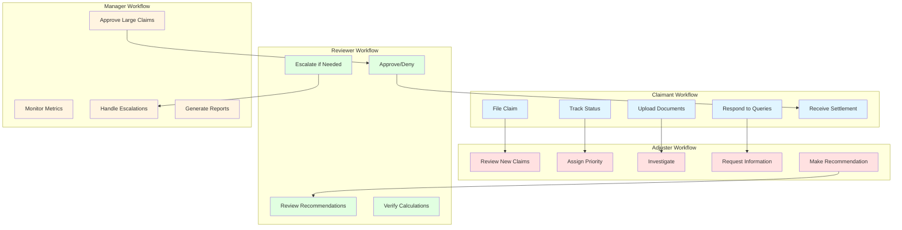
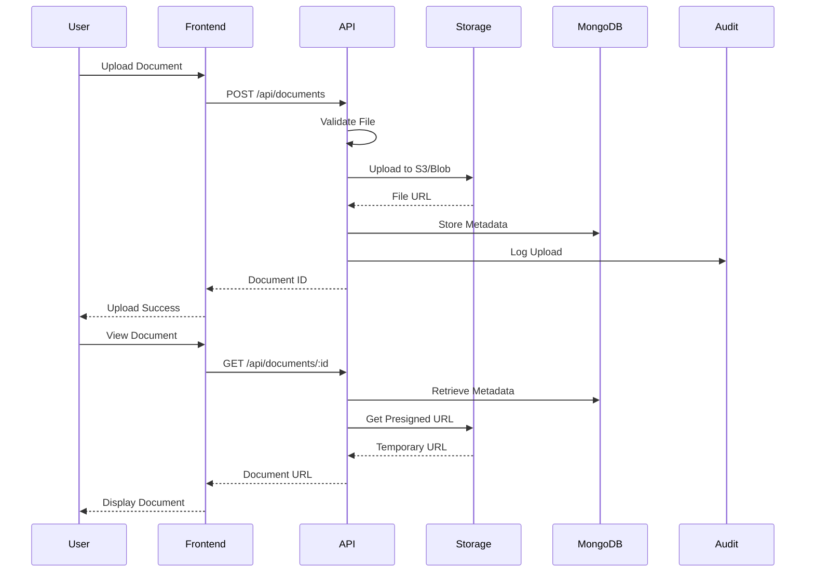
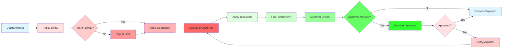
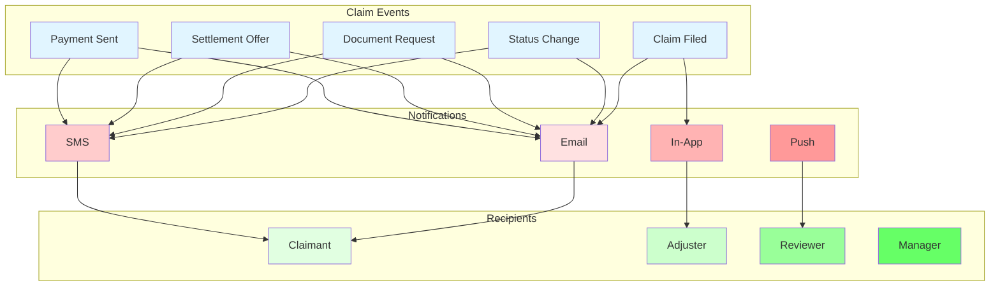

# Claims Management Workflow Diagrams

## Claims Lifecycle Flow

## Detailed Claims Process

## Role-Based Workflows

## Document Management Flow

## Settlement Calculation Flow

## Notification Flow

