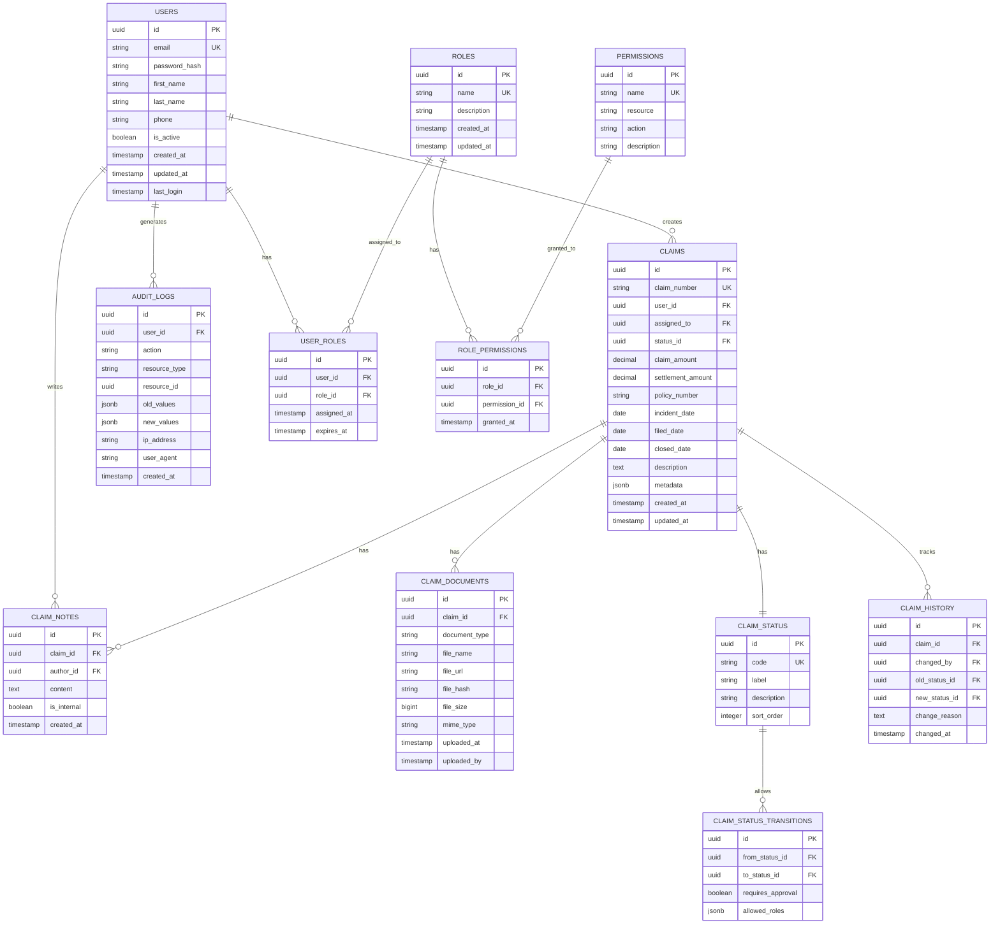
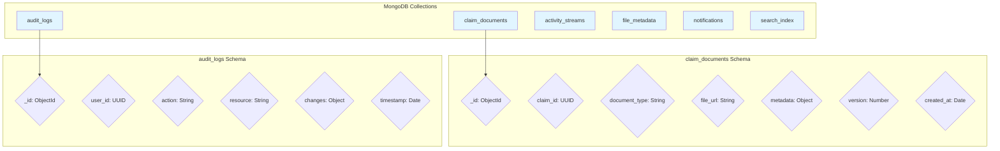
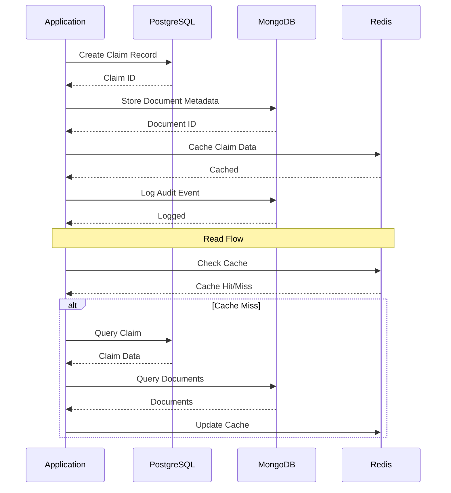
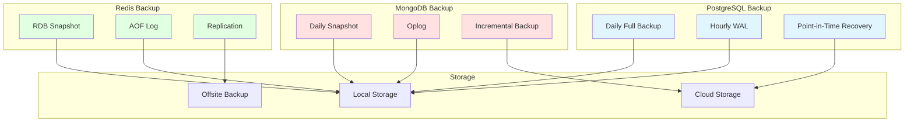

# Database Design Diagrams

## Multi-Database Architecture

```mermaid
graph TB
    subgraph "PostgreSQL - Relational Data"
        P1[Users]
        P2[Claims]
        P3[Claim Status]
        P4[Roles]
        P5[Permissions]
    end

    subgraph "MongoDB - Document Storage"
        M1[Claim Documents]
        M2[Audit Logs]
        M3[Activity Streams]
        M4[File Metadata]
    end

    subgraph "Redis - Cache & Sessions"
        R1[Session Cache]
        R2[Query Cache]
        R3[Rate Limiting]
        R4[Real-time Updates]
    end

    subgraph "Application"
        A[Backend API]
    end

    A --> P1
    A --> P2
    A --> P3
    A --> P4
    A --> P5
    A --> M1
    A --> M2
    A --> M3
    A --> M4
    A --> R1
    A --> R2
    A --> R3
    A --> R4

    style P1 fill:#e1f5ff
    style P2 fill:#e1f5ff
    style P3 fill:#e1f5ff
    style P4 fill:#e1f5ff
    style P5 fill:#e1f5ff
    style M1 fill:#ffe1e1
    style M2 fill:#ffe1e1
    style M3 fill:#ffe1e1
    style M4 fill:#ffe1e1
    style R1 fill:#e1ffe1
    style R2 fill:#e1ffe1
    style R3 fill:#e1ffe1
    style R4 fill:#e1ffe1
```



## PostgreSQL Schema



## MongoDB Collections



## Data Flow Between Databases



## Indexing Strategy

```mermaid
graph TB
    subgraph "PostgreSQL Indexes"
        I1[Users: email]
        I2[Claims: claim_number]
        I3[Claims: user_id]
        I4[Claims: status_id]
        I5[Claims: created_at]
        I6[Audit: user_id]
        I7[Audit: created_at]
    end

    subgraph "MongoDB Indexes"
        M1[claim_documents: claim_id]
        M2[claim_documents: document_type]
        M3[audit_logs: user_id]
        M4[audit_logs: timestamp]
        M5[activity_streams: user_id]
    end

    subgraph "Redis Keys"
        R1[session:{user_id}]
        R2[claim:{claim_id}]
        R3[user_claims:{user_id}]
        R4[rate_limit:{user_id}]
    end

    style I1 fill:#e1f5ff
    style I2 fill:#e1f5ff
    style I3 fill:#e1f5ff
    style I4 fill:#e1f5ff
    style I5 fill:#e1f5ff
    style I6 fill:#e1f5ff
    style I7 fill:#e1f5ff
    style M1 fill:#ffe1e1
    style M2 fill:#ffe1e1
    style M3 fill:#ffe1e1
    style M4 fill:#ffe1e1
    style M5 fill:#ffe1e1
    style R1 fill:#e1ffe1
    style R2 fill:#e1ffe1
    style R3 fill:#e1ffe1
    style R4 fill:#e1ffe1
```

## Database Migration Flow

```mermaid
graph LR
    A[Migration Script] --> B[Version Control]
    B --> C[Apply to Dev]
    C --> D[Test Data]
    D --> E[Apply to Staging]
    E --> F[Integration Tests]
    F --> G[Apply to Production]
    G --> H[Backup Rollback]

    style A fill:#e1f5ff
    style B fill:#ffe1e1
    style C fill:#ffcccc
    style D fill:#ffb3b3
    style E fill:#ff9999
    style F fill:#ff6666
    style G fill:#ff3333
    style H fill:#e1ffe1
```



## Data Consistency Strategy

```mermaid
graph TB
    subgraph "ACID Transactions"
        T1[PostgreSQL]
        T2[Atomic Operations]
        T3[Rollback Support]
    end

    subgraph "Eventual Consistency"
        E1[MongoDB]
        E2[Async Replication]
        E3[Conflict Resolution]
    end

    subgraph "Cache Invalidation"
        C1[Redis]
        C2[TTL-based]
        C3[Write-through]
    end

    T1 --> T2
    T2 --> T3
    E1 --> E2
    E2 --> E3
    C1 --> C2
    C2 --> C3

    style T1 fill:#e1f5ff
    style T2 fill:#e1f5ff
    style T3 fill:#e1f5ff
    style E1 fill:#ffe1e1
    style E2 fill:#ffe1e1
    style E3 fill:#ffe1e1
    style C1 fill:#e1ffe1
    style C2 fill:#e1ffe1
    style C3 fill:#e1ffe1
```



## Backup Strategy


