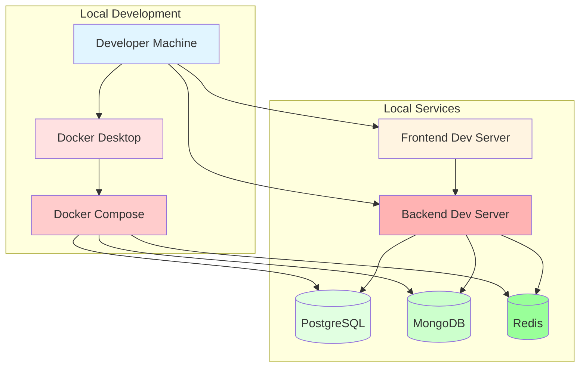
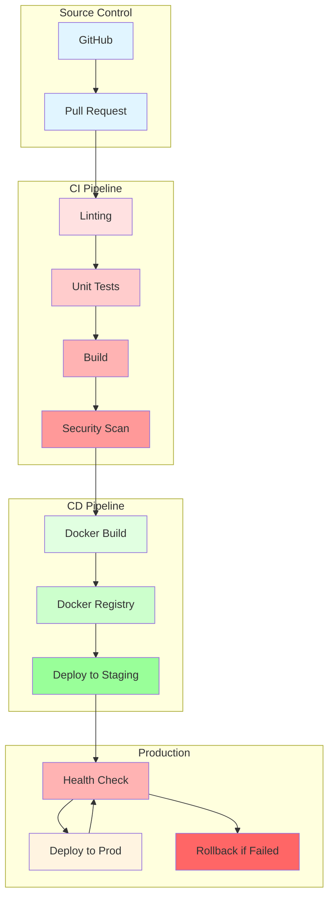
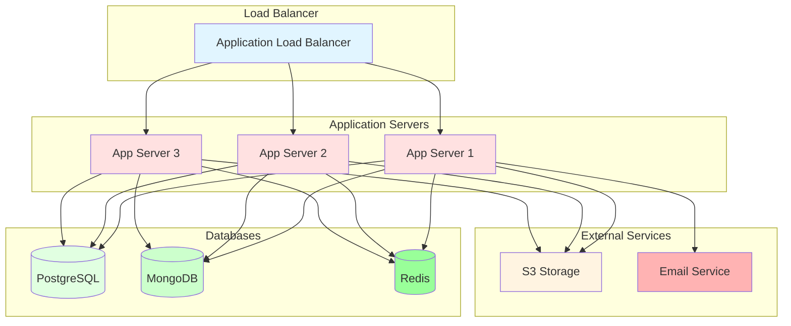
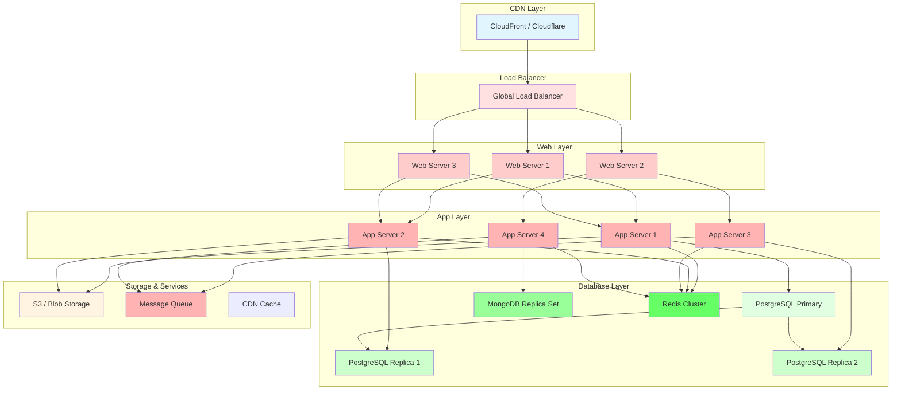
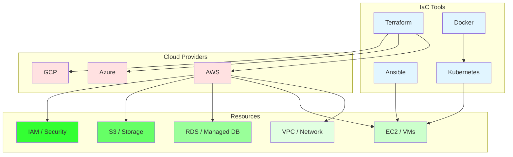
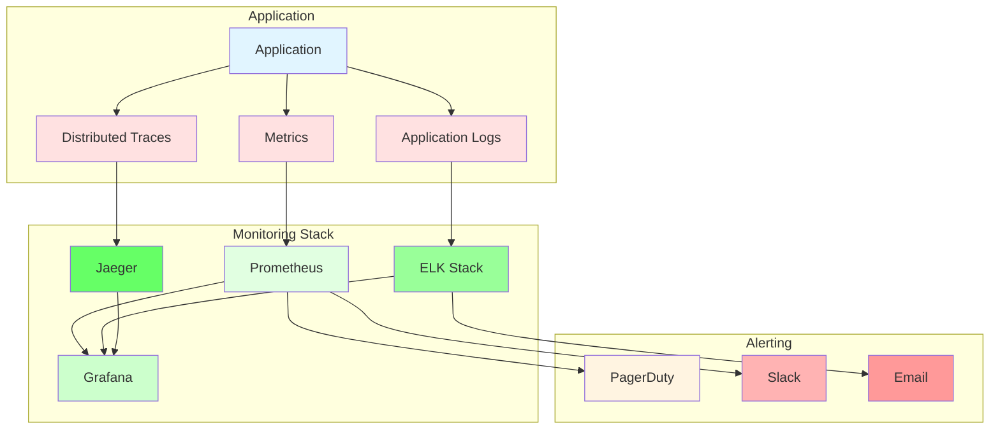
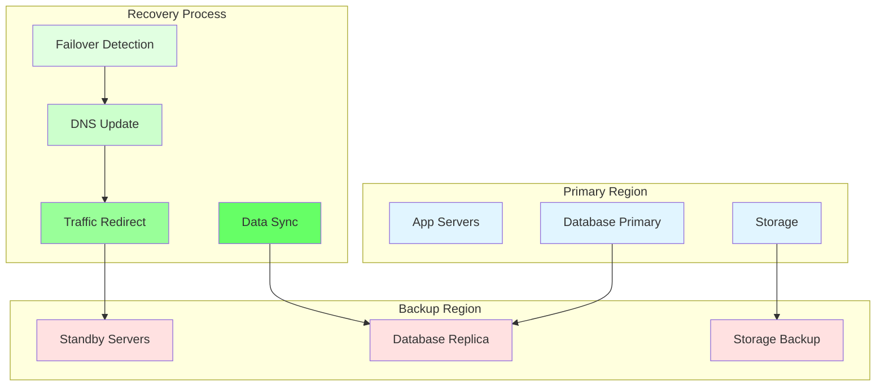
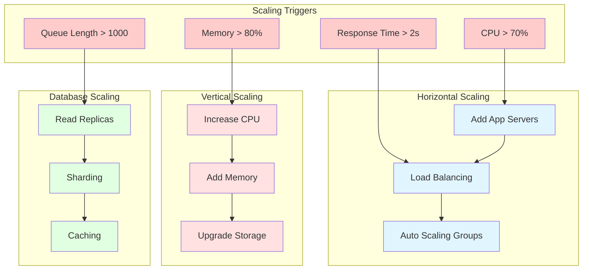

# Deployment Architecture Diagrams

## Development Environment

## CI/CD Pipeline

## Staging Environment

## Production Environment

## Infrastructure as Code

## Monitoring & Observability

## Disaster Recovery

## Scaling Strategy

