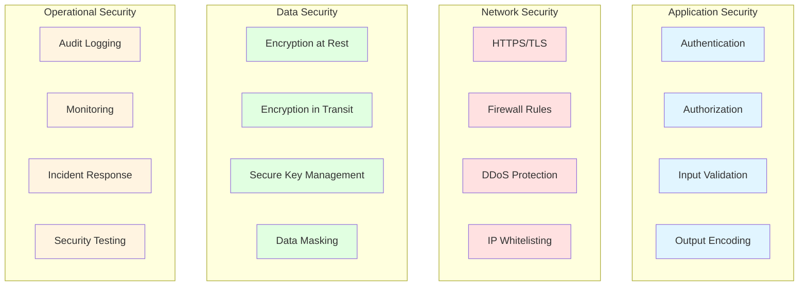
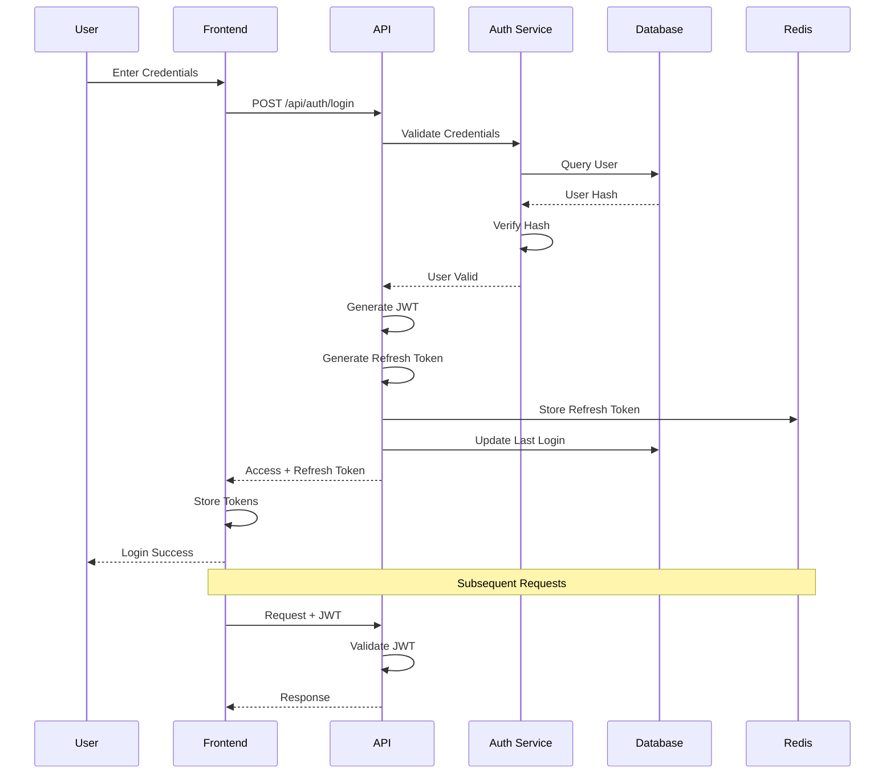
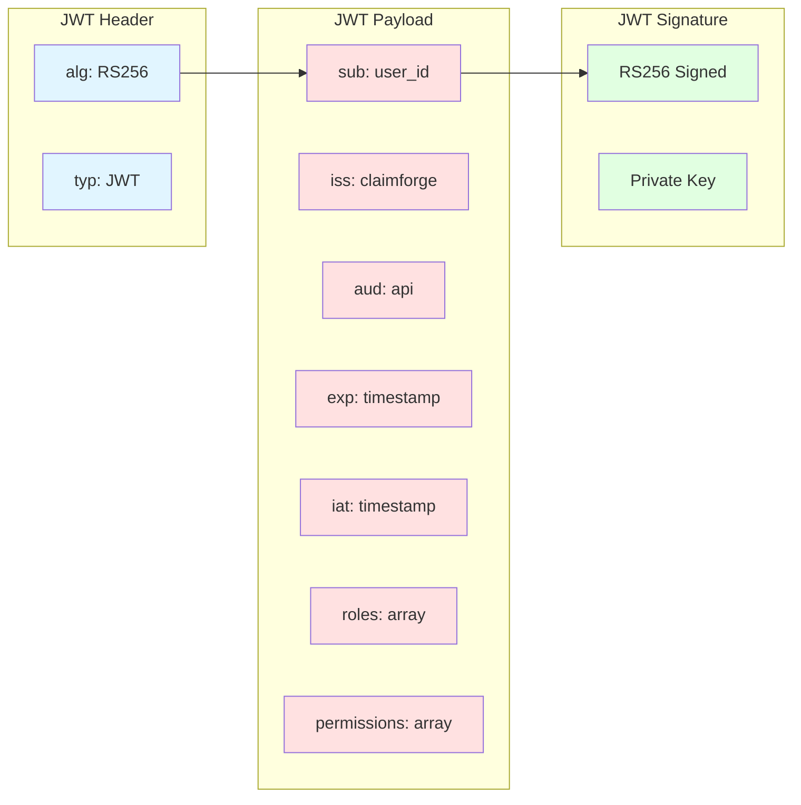
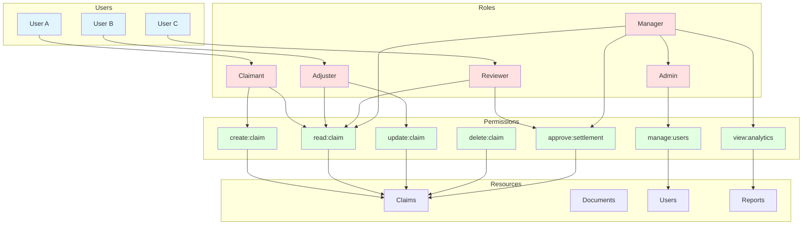
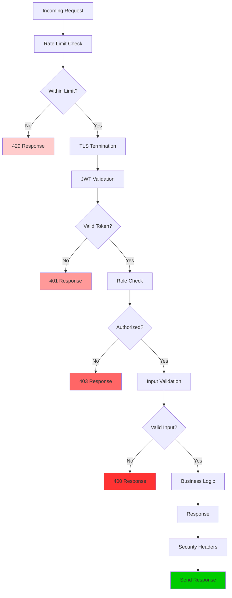
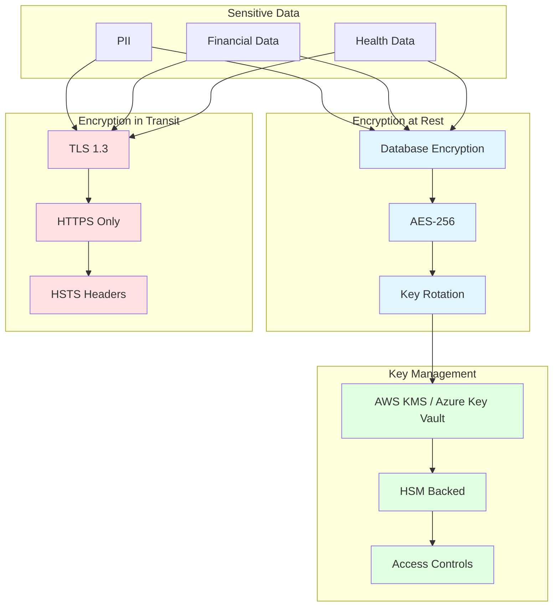
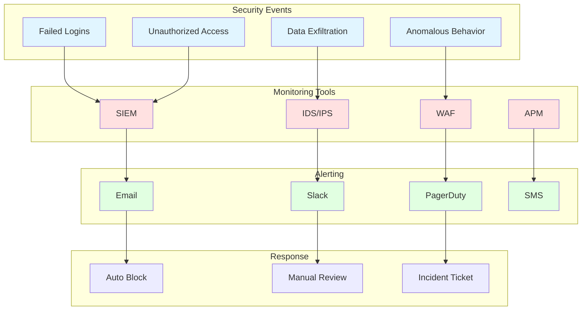
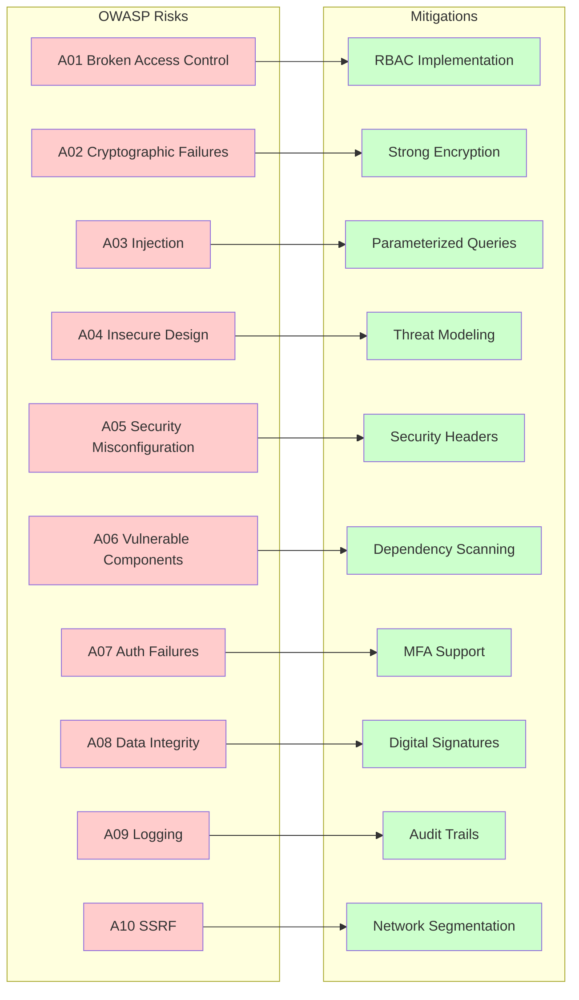

# Security Architecture Diagrams

## Security Layers



## Authentication Flow



## JWT Token Structure



## Role-Based Access Control (RBAC)



## Request Security Pipeline



## Data Encryption



## Audit Logging

```mermaid
sequenceDiagram
    participant User
    participant API
    participant Audit Service
    participant MongoDB
    participant SIEM

    User->>API: Perform Action
    API->>API: Validate Request
    API->>Audit Service: Log Event
    Audit Service->>MongoDB: Store Log
    Audit Service->>SIEM: Forward Event
    API-->>User: Response

    Note over Audit Service,SIEM: Log includes:
    - User ID
    - Action
    - Resource
    - Timestamp
    - IP Address
    - User Agent
    - Changes (before/after)
```

## Security Monitoring



## OWASP Top 10 Mitigations


