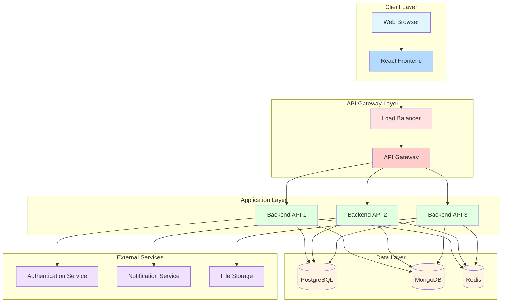
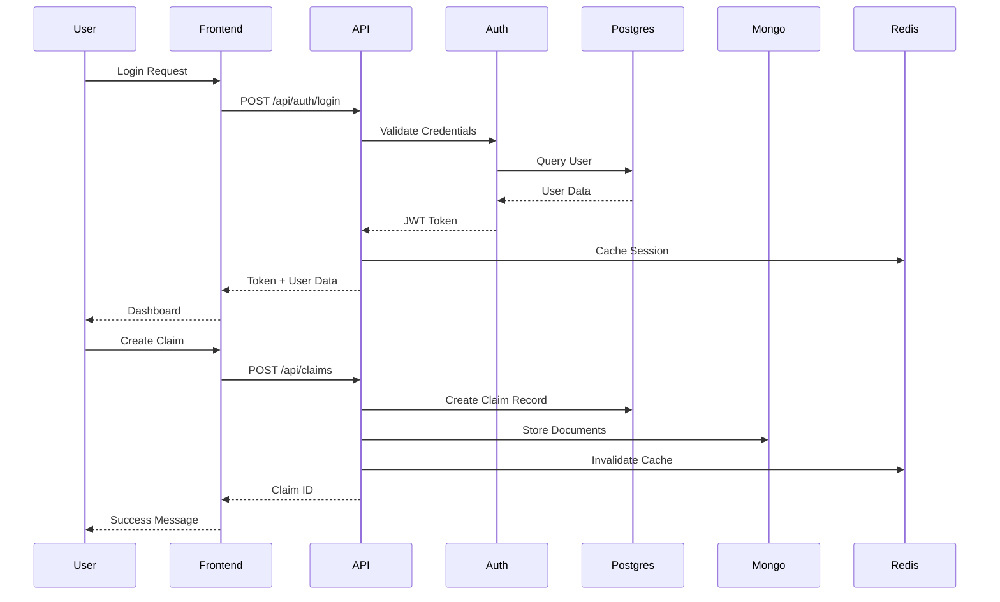
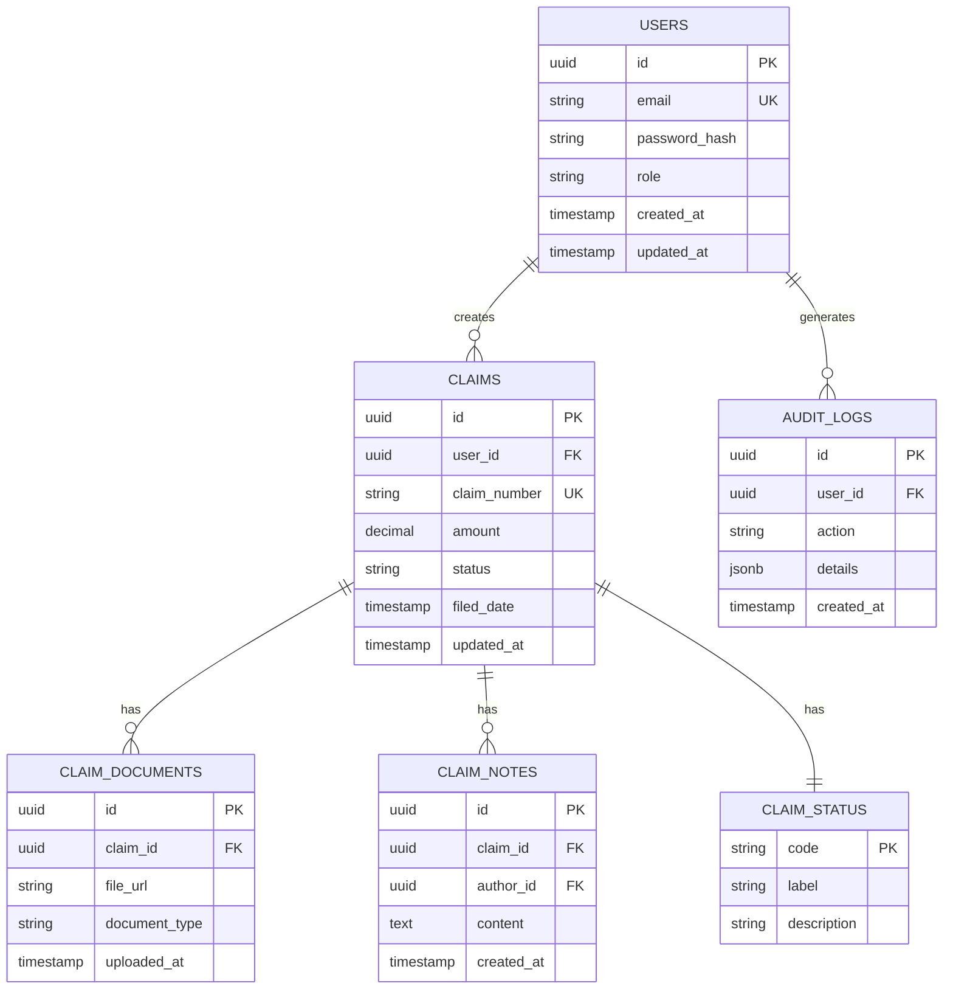
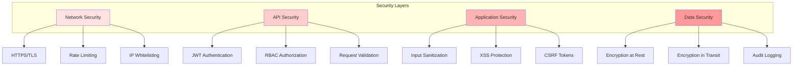

# System Architecture Diagram

## High-Level Architecture



## Component Interactions



## Data Flow Architecture


## Database Schema Overview



## Security Architecture



## Deployment Architecture

```mermaid
graph TB
    subgraph "Development"
        Dev[Local Docker Compose]
    end

    subgraph "Staging"
        Staging[Staging Environment]
        StagingDB[(Staging DB)]
    end

    subgraph "Production"
        Prod[Production Cluster]
        ProdDB[(Production DB)]
        CDN[CDN]
        LB[Load Balancer]
    end

    Dev --> Staging
    Staging --> Prod
    Prod --> CDN
    Prod --> LB
    LB --> ProdDB

    style Dev fill:#e1ffe1
    style Staging fill:#ccffcc
    style Prod fill:#99ff99
    style CDN fill:#66ff66
    style LB fill:#33ff33
```
